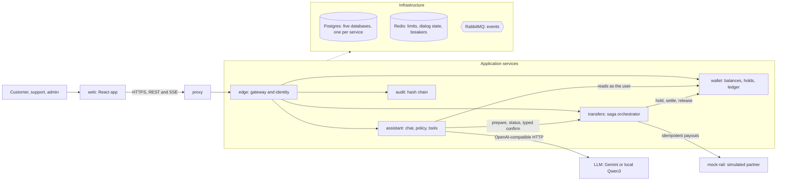
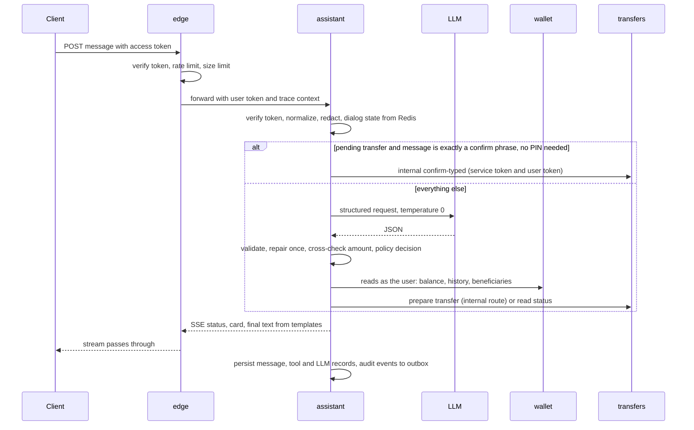
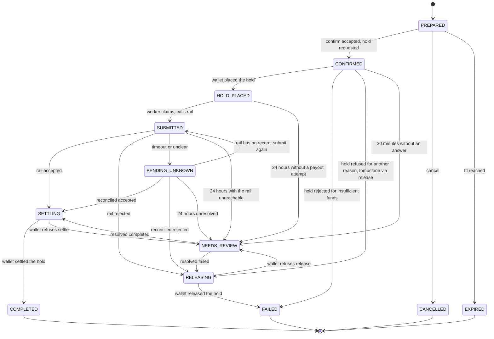
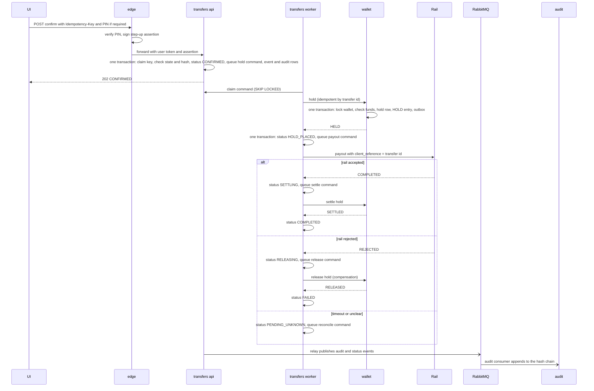

# Architecture: Sahayak

Status: DRAFT for approval. Implements `PRD.md`. Significant decisions are recorded in `specs/decisions/` (ADR-001 to ADR-019) and indexed at the end. Revised 2026-10-15: the system is five services with a database each, a saga for transfers and RabbitMQ events (ADR-015 to ADR-019 supersede the monolith of ADR-001).

## 1. Design principles

1. **The model proposes, deterministic code disposes.** The LLM output is untrusted input. It is validated into a proposal, checked by a policy engine, and executed by typed tools using the authenticated user's identity.
2. **Facts come from tools, words come from templates.** Balances, amounts, recipients and statuses are rendered from service results through locale templates. The model never writes a number a user relies on.
3. **Data minimization toward the model.** Prompts contain only the user's own messages and curated knowledge-base text. Ledger and beneficiary data never enter prompts, which also shrinks the prompt-injection surface.
4. **Fail closed, degrade gracefully.** Anything unclear becomes a clarification or a refusal. When the LLM (or the whole assistant) is down, deterministic quick actions still work.
5. **A service owns its data; consistency across services is a saga.** Each service's Postgres database is the system of record for its own facts. A business operation that spans services is a sequence of local transactions with durable, idempotent commands and compensation, never a distributed transaction.
6. **Never call out from inside a transaction.** A transaction commits local state plus an outbox row; a worker performs the call afterwards.
7. **Every boundary is a contract.** Public APIs, internal APIs and events are Zod schemas in `packages/shared`, versioned, and tested from both sides.
8. **Boring, observable shape.** Stateless processes, ports and adapters at every external boundary, one shared platform library for the cross-cutting policies (timeouts, breakers, outbox, service security) so they are implemented and tested once.

## 2. System context



## 3. Deployable units

| Unit | Role | Notes |
|---|---|---|
| `web` | React and Vite single-page app: customer chat and the role-gated admin console. | Static build behind the proxy. Talks to `edge` only. |
| `proxy` | Reverse proxy in front of `edge` replicas (round-robin, no sticky sessions); serves `web`. | Enables the scale test. Never routes to internal listeners. |
| `edge` | Public API: login, refresh, PIN check and step-up, token signing, per-IP and per-user limits, CORS, headers, routing of public routes to the other services, SSE pass-through. | Owns `edge_db`. Stateless. |
| `assistant` | Conversations, turn pipeline, LLM gateway, policy, tools, templates, FAQ, tickets, admin conversation inspection, evaluation results, consumer of transfer status events. | Owns `assistant_db`. Stateless. |
| `wallet` | Balances, holds, ledger entries, beneficiaries, history. Idempotent hold, settle and release commands. | Owns `wallet_db`. The only writer of balances. |
| `transfers` | Transfer state machine, saga orchestrator, confirm, idempotency keys, limits, rail adapter, reconciliation, expiry, admin transfer actions. | Owns `transfers_db`. Runs `api` and `worker` roles. |
| `audit` | Consumes audit events, appends to the hash chain, verifies, anchors, serves the admin audit view. | Owns `audit_db`. Only service with write access to it. |
| `mock-rail` | Simulated payment partner: idempotent payouts by client reference, fault injection (latency, 5xx, timeouts, lost responses, duplicates). | Lets reliability be tested for real. |
| `postgres` | One container, five databases, separate roles per database. | An application role can connect only to its own database. |
| `redis` | Rate limits, dialog state, circuit-breaker state, short caches. Key prefix per service. | Losing it never loses facts. |
| `rabbitmq` | Event broker (ADR-017). | Durable queues, DLQs, management UI. |
| `observability` profile | Prometheus, Grafana, Jaeger (OTLP). | Optional compose profile. |

Every service image has two roles selected by `SERVICE_ROLES` (`api`, `worker`; both by default). The worker role runs the outbox relay, consumers and scheduled jobs. Roles can be scaled separately.

## 4. Repository layout and dependency rules

```
sahayak/
  apps/
    edge/  assistant/  wallet/  transfers/  audit/     each: src/{domain,app,adapters,main}, migrations/, seed/
    mock-rail/
    web/
  packages/
    shared/          Zod contracts (public API, internal API, events, errors), enums, service access matrix,
                     pure utilities (money, canonical JSON, redaction, clock port, ids), locale catalogs, lexicon
    platform/        infrastructure kit, no business logic: config, logging, request context, service skeleton
                     (Fastify), route policies, JWT verification, service tokens, database kit and test harness,
                     Redis adapters, circuit breaker, bulkhead, rate limiter, outbox relay, inbox, RabbitMQ client,
                     telemetry
    assistant-core/  pure assistant domain: parsers, interpreter, policy, tools, dialog, pipeline, templates
    llm/             model gateway adapters and wrappers
    evals/           datasets, runners, reports (CLI)
  infra/             compose files, proxy config, database init, RabbitMQ definitions, Prometheus rules, Grafana, k6
  tools/             cross-platform scripts (Node.js)
  specs/             source of truth for requirements and decisions
  .github/workflows/
```

Dependency direction (enforced by dependency-cruiser in CI, NFR-MAINT-1 and NFR-ARCH-1):

- `shared` imports nothing internal and has no I/O.
- `platform` imports `shared` only.
- `assistant-core` imports `shared` only (pure; no Fastify, SQL, Redis or HTTP clients).
- `llm` imports `shared` and `platform`.
- `evals` imports `assistant-core`, `llm`, `shared`, and talks to a running stack through `edge`.
- Each app imports packages and **never another app**. Inside an app, `domain` imports `shared` only, `app` imports `domain`, and `adapters` implement ports defined by `domain` and `app`. `main` is the only composition root.
- `web` imports `shared` only.
- No cycles.

The HTTP layer is a thin adapter over use cases, so Fastify could be replaced without touching domain code (ADR-002).

## 5. The assistant turn pipeline



Stages in order (details in F02 and F03), all inside the `assistant` service:

1. **Authenticate and limit.** `edge` verified the token and applied IP limits; `assistant` verifies the token again, applies the per-user message limit, rejects oversized input.
2. **Normalize.** Unicode normalization, control-character stripping, script and language detection (en, hi, hi-Latn), deterministic amount and date parsing from the raw text, PII redaction for the prompt.
3. **Dialog manager.** Load short-lived state. If a transfer is pending and the message is exactly a confirm or cancel phrase (and no PIN is required), handle it deterministically with no model call.
4. **Interpreter.** One LLM call returning a structured interpretation: language, intent, entities, confidence, missing fields. Validate, repair once, cross-check the amount against the deterministic parse.
5. **Policy engine.** A pure decision table: ALLOW, CLARIFY (with the missing slot), NEEDS_CONFIRMATION, or DENY (with a reason), based on intent, role, limits and state.
6. **Tool execution.** Typed tools call `wallet` and `transfers` **as the user** (the user's token is forwarded; the target service enforces ownership). Recipient resolution happens here, server-side, against the user's beneficiaries read from `wallet`. At most 4 tool executions per turn.
7. **Respond.** Templates render the result in the user's locale. Only FAQ answers use a second LLM call, grounded on retrieved knowledge-base snippets and passed through the output guard.
8. **Persist and emit.** Store the message with interpretation and policy decision, write LLM-call records, queue audit events, stream SSE events (`status`, `delta`, `card`, `final`, `error`).

If the LLM stage fails, the pipeline returns the fallback menu (FR-CONV-5). If the whole `assistant` is down, `edge` returns 503 for chat routes only; the wallet and transfer routes are unaffected, so the UI's fallback mode keeps working.

## 6. Money model and the transfer saga

### 6.1 Ledger (in `wallet`)

Amounts are integer paise (`BIGINT`). Each wallet has `available_minor` and `held_minor`, both non-negative. The `ledger_entries` table is append-only with kinds `CREDIT`, `HOLD`, `SETTLE`, `RELEASE`. A `holds` table has one row per transfer id with a state `HELD`, `SETTLED`, `RELEASED`, `REJECTED` or `VOIDED`. Invariants, checked by property tests and a periodic consistency query:

- `available = sum(CREDIT) - sum(HOLD) + sum(RELEASE)`
- `held = sum(HOLD) - sum(SETTLE) - sum(RELEASE)`
- `available >= 0` and `held >= 0`
- exactly one of SETTLE or RELEASE per HOLD, never both

Wallet commands (idempotent by transfer id, all in one local transaction that locks the wallet row):

| Command | When the hold is... | Result |
|---|---|---|
| hold | absent and funds suffice | `HELD`; HOLD entry; `available -= amount`, `held += amount` |
| hold | absent and funds do not suffice | `REJECTED` recorded; `422 INSUFFICIENT_FUNDS` |
| hold | already `REJECTED` | `422 INSUFFICIENT_FUNDS` again (the same answer, so a lost response is harmless) |
| hold | `VOIDED` | `409 HOLD_VOIDED` (a late retry after the saga gave up) |
| hold | already `HELD`, `SETTLED` or `RELEASED` | `200` with the current state; nothing changes |
| settle | `HELD` | `SETTLED`; SETTLE entry; `held -= amount` |
| settle | `SETTLED` | `200`, no change |
| settle | `RELEASED`, `REJECTED`, `VOIDED` or absent | `409 HOLD_STATE_CONFLICT` |
| release | `HELD` | `RELEASED`; RELEASE entry; `held -= amount`, `available += amount` |
| release | `RELEASED`, `VOIDED` or `REJECTED` | `200`, no change |
| release | absent | `VOIDED` tombstone written; `200` |
| release | `SETTLED` | `409 HOLD_STATE_CONFLICT` |

### 6.2 Transfer states (in `transfers`)



Every transition writes a `transfer_events` row, the next saga command (when there is one), a status event and an audit event, all in the same local transaction, and sets `status_since`. Only the transitions drawn above are legal. Time-in-status rules (30 minutes in `CONFIRMED`, 24 hours in `HOLD_PLACED`, `SUBMITTED` or `PENDING_UNKNOWN`) are measured from `status_since` (for `HOLD_PLACED` and `SUBMITTED` together, from `hold_placed_at`) and applied by the watchdog.

**Entering `NEEDS_REVIEW`** cancels the transfer's unprocessed commands, remembers the origin in `review_from_status`, and raises an alert. The hold, if any, stays. **Leaving it** is only by admin action, and what is allowed depends on the origin:

| Origin (`review_from_status`) | Allowed resolution |
|---|---|
| `CONFIRMED` | `FAILED` only: queues a release (which writes a tombstone if no hold exists, so a late hold is refused) |
| `HOLD_PLACED` | `FAILED` only when no payout was ever attempted (`submitted_at` is null): queues a release |
| `SUBMITTED`, `PENDING_UNKNOWN` | `COMPLETED` (to `SETTLING`) or `FAILED` (to `RELEASING`), after the rail check below |
| `SETTLING` | `COMPLETED` only: re-queues the settle after the operator has repaired the cause |
| `RELEASING` | `FAILED` only: re-queues the release after the operator has repaired the cause |

**Rail check.** When `submitted_at` is set, resolve first looks the payout up at the rail: a definitive `COMPLETED` allows only `COMPLETED`; `REJECTED` or no record allows only `FAILED`; `PENDING` or an unreachable rail refuses both unless the admin sends `force: true` with a reason (recorded in the audit event as forced). Resolve is also refused (`409 TRANSFER_BUSY`) while any command of the transfer holds an active lease, so a worker that is mid-call cannot race the decision. This keeps the dangerous direction (marking a transfer failed and returning the money after the rail already paid) out of reach except by a deliberate, audited override.

### 6.3 Confirm and settlement (the saga)



The saga in one table (ADR-016): step 1 hold (compensable); step 2 payout (**pivot**, cannot be undone); step 3 settle or release (retried until it succeeds). Failure handling per step is in F05.

Why this is safe, in four sentences. Progress is durable: each state change and the next command commit together, so a crash at any point resumes from the command queue. Every participant is idempotent on the transfer id, so a command may be sent twice or late without effect, and a release before a hold leaves a tombstone that blocks a late hold. The payout is idempotent on the client reference, and a lost response ends in `PENDING_UNKNOWN` and is resolved by looking the payout up, never guessed. The assistant words its messages from the stored status and never claims a result before a terminal state.

A **saga watchdog** (a scheduled job in the `transfers` worker) re-queues the appropriate command for any transfer that sits in an intermediate status with no pending command, so even a lost or wrongly deleted command cannot leave money in limbo silently. The same job applies the time-in-status horizons (to `NEEDS_REVIEW`), so a transfer cannot wait forever behind an open breaker or an unreachable wallet without a human being told.

### 6.4 Cross-service consistency checks

Single-database invariants (6.1) are enforced by the wallet. Cross-service invariants cannot be database constraints, so a **consistency sweep** (test utility, read-only access through the test-only `sahayak_sweep` role, used after every system test and exposed as `pnpm sweep:consistency`) checks:

- every `COMPLETED` transfer has a `SETTLED` hold for its id and amount;
- every `FAILED`, `CANCELLED` and `EXPIRED` transfer has no `HELD` hold;
- every `HELD` hold belongs to a transfer in `HOLD_PLACED`, `SUBMITTED`, `PENDING_UNKNOWN`, `NEEDS_REVIEW`, `SETTLING` or `RELEASING` (or `CONFIRMED` while the command is in flight);
- every `COMPLETED` transfer has exactly one completed payout at the rail, and every `FAILED`, `CANCELLED` and `EXPIRED` transfer has none (queried through the mock rail's test endpoint, which counts payouts that moved money);
- every `audit.recorded` row in any service's outbox has a matching entry in the audit chain once the lag has passed (the completeness check of F07).

## 7. Where state lives and how services talk

| State | Owner and store | Notes |
|---|---|---|
| Users, credentials, refresh tokens, PIN state | `edge`, `edge_db` | |
| Wallets, ledger, holds, beneficiaries | `wallet`, `wallet_db` | Only the wallet writes balances. |
| Transfers, transfer events, idempotency keys, saga commands | `transfers`, `transfers_db` | |
| Conversations, messages, tool invocations, LLM calls, knowledge base, tickets, eval runs and results | `assistant`, `assistant_db` | Masked content; retention configurable. |
| Audit log | `audit`, `audit_db` | Hash-chained, insert-only role, written only by the audit service. |
| Event outbox and inbox | Each service's own database | Same transaction as the business change. |
| Dialog state (pending clarification, pending transfer id) | `assistant`, Redis, 30-minute TTL | Rebuildable: the pending transfer is also in `transfers_db`. |
| Rate-limit counters, login throttles, circuit-breaker state | Redis, key prefix per service | Shared across replicas; disposable. |

**Synchronous calls** (HTTP, JSON, the contracts in `packages/shared`):

| Caller | Callee | Purpose | Identity used |
|---|---|---|---|
| `web` | `edge` | Everything public | User token |
| `edge` | `assistant`, `wallet`, `transfers`, `audit` | Public routes, forwarded | User token (verified again by the callee) |
| `assistant` | `wallet` | Balance, history, beneficiaries | User token |
| `assistant` | `transfers` | Status reads (user token); prepare and typed confirm (internal routes) | User token plus service token |
| `transfers` | `wallet` | Balance pre-check and beneficiary lookup at prepare (synchronous); hold, settle, release (saga commands, asynchronous from the queue) | Service token (plus user id in the command) |
| `transfers` | `mock-rail` | Payouts and lookups | Rail key |
| `assistant` | LLM provider | Interpretation, FAQ composition | Provider key |

A request path has at most three synchronous hops. The longest path today is `edge` to `assistant` to `transfers` to `wallet` (a chat message that prepares a transfer). Each hop has a smaller timeout than its caller: `edge` to a service 10 s (streams excepted); `assistant` to `transfers` 5 s (because `transfers` itself calls `wallet` while serving the request, and issues its two prepare-time lookups in parallel); calls to a service that makes no further calls (`assistant` to `wallet`, `transfers` to `wallet`) 3 s; rail 5 s and LLM 15 s (both called from background or streaming paths). Internal routes live on a separate listener and are never routed by the proxy or `edge`.

**Asynchronous events** (RabbitMQ, ADR-017; catalog in `specs/EVENTS.md`): `audit.recorded` from every service to `audit`; `transfer.status_changed` from `transfers` to `assistant` (completed, failed, needs review) so the originating conversation gets a templated update; no event has a consumer in `wallet`, which only receives commands. Delivery is at-least-once; consumers deduplicate through an inbox.

## 8. LLM gateway (in `packages/llm`, used by `assistant`)

A single port, `LlmClient.completeStructured(request, schema)`, with adapters:

- **OpenAI-compatible adapter**: base URL, key and model come from config, so the same code reaches the hosted model and a local Ollama or vLLM server.
- **Scripted fake**: returns predefined outputs keyed by utterance. Used in unit, integration, end-to-end and CI workflow evals.
- **Wrappers** (decorators, using the `platform` primitives): timeout, retry with jittered backoff, circuit breaker with state in Redis, a concurrency limiter (bulkhead: default 20 calls in flight per replica, at most 2 s wait for a slot, then fallback with reason `overloaded`), redaction for providers not marked `trusted`, metrics and the `llm_calls` record.

Structured output: request JSON-schema output where the provider supports it, otherwise JSON mode with the schema in the prompt; always validate with Zod; on failure send one repair request that includes the validation errors; then give up to clarification or fallback. Temperature 0, capped output tokens. Thinking mode is turned off for classification on models that have it.

## 9. Security architecture

| Boundary | Treated as | Controls |
|---|---|---|
| Browser to `edge` | Untrusted | Token auth, RBAC, input schemas, CORS, headers, size and rate limits |
| `edge` to services | Not trusted by default | Every service verifies the user token itself (EdDSA, public key only), applies role and ownership checks itself |
| Service to service | Authenticated, least privilege | Internal routes on a separate listener; signed 60-second service tokens; per-route caller access matrix (ADR-018) |
| LLM output | Untrusted | Schema validation, policy engine, allowlisted tools, no authority |
| User text, notes, names | Untrusted data | Delimited in prompts, escaped in the UI, never concatenated into instructions |
| Rail responses and webhooks | Semi-trusted | Schema validation, signature check (webhook), idempotent state transitions |
| Events | Authenticated producers, untrusted payload | Schema validation on consume, idempotent consumers, DLQ for poison |
| Logs and telemetry | Must be clean | Masking at the logger and exporter |

Transfer confirmation never depends on the model: it is the confirm API (button, plus a PIN step-up assertion above the threshold) or a deterministic phrase match against one pending transfer, performed by deterministic code in `assistant` and accepted by `transfers` only below the PIN threshold (ADR-008, ADR-018). A compromised `assistant` can at worst confirm a transfer the user already prepared, below the PIN threshold.

## 10. Reliability patterns

Per service: idempotency keys with request hashing (`transfers`); idempotent commands keyed by transfer id (`wallet`); transactional outbox and inbox; saga with compensation, tombstones and a watchdog; `FOR UPDATE SKIP LOCKED` workers; row-level wallet locking; explicit state machine with an allowed-transition table; timeouts everywhere with decreasing budgets; retries only on idempotent operations; one reusable circuit breaker (state in Redis; losing Redis resets breakers to closed) used for the LLM, the rail and each service-to-service client; a concurrency limit (bulkhead) on LLM calls that sheds load to fallback mode; fallback mode; reconciliation for ambiguous outcomes; dead-letter queues; graceful shutdown; readiness tied to dependencies (Postgres required, Redis degraded, RabbitMQ degraded for producers because the outbox keeps events).

Which failure each pattern addresses, and the patterns deliberately not used (service mesh, commercial gateway, workflow engine, two-phase commit, hedged requests), are in ADR-014.

## 11. Observability

- **Logs:** pino JSON, request id and trace id on every line, redaction at the logger.
- **Metrics** (each service exposes `/metrics` on its internal listener; every series carries a `service` label): HTTP RED metrics, `service_call_duration_seconds{caller,callee,outcome}`, `service_breaker_state{callee}`, `assistant_dependency_failure_total{callee}`, `authz_denied_total`, `saga_defect_total{kind}`, `llm_request_duration_seconds{provider,model,outcome}`, `llm_tokens_total`, `interpreter_validation_failures_total`, `assistant_intent_total{intent,lang}`, `assistant_fallback_total{reason}`, `tool_invocations_total{tool,outcome}`, `transfers_total{status}`, `transfer_stuck_count`, `saga_step_duration_seconds{step,outcome}`, `saga_command_lag_seconds`, `saga_watchdog_requeued_total`, `wallet_holds_total{state}`, `idempotency_replays_total`, `rate_limited_total`, `event_outbox_lag_seconds{service}`, `inbox_duplicates_total{consumer}`, `rabbitmq_queue_messages{queue}`, `dlq_messages{queue}`, `audit_lag_seconds`, `rail_requests_total{outcome}`, `rail_breaker_state`, `llm_breaker_state`, `llm_inflight`, `audit_verification_ok`.
- **Traces:** OpenTelemetry spans for HTTP, pipeline stages, LLM calls, tool executions, SQL, service calls, rail calls, outbox relay and consumers; W3C trace context on HTTP calls and in event envelopes, so one trace follows a chat turn across `edge`, `assistant`, `transfers` and `wallet`; trace id echoed in logs and errors.
- **Dashboards (Grafana, as code, five):** service health (RED per service, breaker states), assistant quality (intent mix, fallbacks, validation failures, LLM latency), transfer funnel and saga (statuses, stuck, replays, step durations, command lag, watchdog), messaging (outbox lag, queue depth, DLQs, inbox duplicates, audit lag), platform (DB pools, Redis, RabbitMQ).
- **Alerts (Prometheus rules, as code; this is the single authoritative list, F09 refers to it):** LLM error ratio above 20% for 5 minutes; saga command lag above 60 s; event outbox lag above 60 s; audit lag above 60 s for 2 minutes; any transfer in `PENDING_UNKNOWN` older than 30 minutes; any transfer in `CONFIRMED`, `HOLD_PLACED`, `SUBMITTED`, `SETTLING` or `RELEASING` older than 15 minutes (`transfer_stuck_count`); any transfer in `NEEDS_REVIEW`; any message in a DLQ; `saga_defect_total` increasing (a wallet `HOLD_STATE_CONFLICT`, a refused hold other than for funds, an unexpected hold state); `saga_watchdog_requeued_total` increasing; 5xx ratio above 1% per service; audit verification failure; rail breaker open for more than 5 minutes; any service breaker open for more than 5 minutes.
- **LLM observability:** every call stored in `llm_calls` (masked prompt and response, tokens, latency, outcome, validation error) and viewable in the admin console.

## 12. Scalability

What scales now (tested in the system suite): stateless `edge`, `assistant`, `wallet` and `transfers` replicas behind the proxy with no sticky sessions; `transfers` workers scale independently and cannot double-process (`SKIP LOCKED`); shared Redis for limits and breaker state; consumers can run several instances (the `audit` chain writer is deliberately single-writer, serialized by an advisory lock); read endpoints are cheap indexed queries. A turn is one request with an SSE response, passed through `edge`, so there is no cross-replica streaming problem.

The contention points are intentionally narrow: only the sender's wallet row is locked, and only during a hold, settle or release; the audit chain has one writer.

What would come next (documented in `docs/SCALING.md`, not built): read replicas for history and admin queries; partition `ledger_entries` and `audit_log` by time; a per-day audit chain; Kafka or Redpanda in place of RabbitMQ if event volume demands it; a workflow engine in place of the hand-built saga; a service mesh and mutual TLS; a GPU pool with vLLM for model serving; per-tenant sharding.

## 13. Deployment topologies

- **Local:** `docker compose up` (proxy, edge, assistant, wallet, transfers, audit, mock-rail, web, postgres with five databases, redis, rabbitmq, seed data). `--profile observability` adds Prometheus, Grafana, Jaeger. A `--profile local-llm` option points the gateway at an Ollama server on the host. Base stack within 4 GB RAM.
- **CI:** GitHub Actions with Postgres, Redis and RabbitMQ service containers for integration tests; the full compose stack for system tests where Docker is available.
- **Staging (stretch, FR-OPS-4):** containers on a free-tier host with managed Postgres and Redis and a hosted broker (or a single small VM running compose); hosted model only. Outcome documented either way; with five services and a broker, free tiers may not fit, and that is an acceptable documented result.

## 14. Technology choices and trade-offs

| Concern | Choice | Main alternative | Reason |
|---|---|---|---|
| Runtime and language | Node.js 22 LTS, TypeScript strict | Python | One language across services, worker and UI contracts |
| HTTP framework | Fastify with Zod type provider | Express, NestJS | Schema-first validation fits the safety story; light and fast; replaceable behind adapters |
| Contracts | Zod in `shared`, OpenAPI generated per service | Hand-written OpenAPI, Pact | One source of truth for runtime validation, types, docs and contract tests |
| Database access | Kysely over `pg`, SQL migrations per service | ORM (Prisma, Drizzle) | Money paths need explicit SQL, locks and transactions with full type safety |
| Service decomposition | Five services, database per service | Modular monolith | Demonstrating distributed consistency across services (ADR-015) |
| Cross-service transactions | Orchestrated saga, idempotent commands | Choreography, 2PC, workflow engine | Visible state, explicit compensation (ADR-016) |
| Events | RabbitMQ with outbox and inbox | Kafka, Redis Streams, NATS | Durable, light enough for a laptop, has a demo UI (ADR-017) |
| Auth | EdDSA JWT verified by every service, rotating refresh, argon2id, PIN step-up assertion | Sessions, opaque tokens, mTLS | Zero-trust between services without a mesh (ADR-018) |
| Audit | Event-fed hash chain in its own service | In-transaction audit | A compromised service cannot rewrite its own evidence (ADR-019) |
| LLM integration | OpenAI-compatible HTTP, own structured-output layer | Vendor SDKs, native tool calling | Provider-agnostic; reliable with small open models |
| Frontend | React, Vite, TanStack Query | Next.js | Pure SPA is enough; SSE client is simple |
| Tests | Vitest, real Postgres, Redis and RabbitMQ, Playwright, k6, fast-check | Mocked infrastructure | Money, concurrency and messaging bugs only show up against real systems |
| Observability | OpenTelemetry, Prometheus, Grafana, Jaeger | Hosted APM | Free, local, reproducible |

## 15. ADR index

| ADR | Title | Status |
|---|---|---|
| 001 | Modular monolith with worker and simulated rail | Superseded by 015 |
| 002 | Node.js, TypeScript, Fastify, Zod, pnpm monorepo with enforced boundaries | Amended |
| 003 | The model proposes, policy disposes | |
| 004 | Structured output with validation and repair, behind an LLM gateway | |
| 005 | Money as integer paise with a hold-based ledger | Amended |
| 006 | Idempotency design | Amended |
| 007 | Transactional outbox with SKIP LOCKED workers | Extended |
| 008 | Confirmation channels never include the model | |
| 009 | Hash-chained, insert-only audit log | Amended by 019 |
| 010 | Authentication and token strategy | Amended by 018 |
| 011 | Observability stack | Amended |
| 012 | Testing strategy with real dependencies and scripted models | Amended |
| 013 | Facts from templates, language handling and locale catalogs | |
| 014 | Resilience patterns used and deliberately not used | Revised |
| 015 | Five services with a database per service | New |
| 016 | Orchestrated saga for transfers; events for side effects | New |
| 017 | Messaging with RabbitMQ, transactional outbox and idempotent consumers | New |
| 018 | Service identity, user tokens and step-up assertions | New |
| 019 | Audit by events, ingested by an independent service | New |
