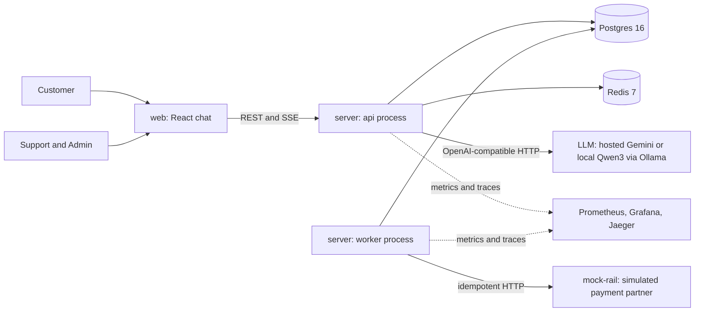
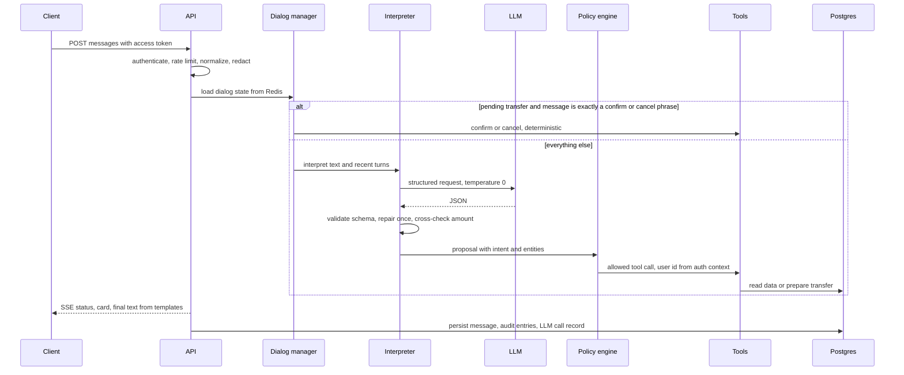
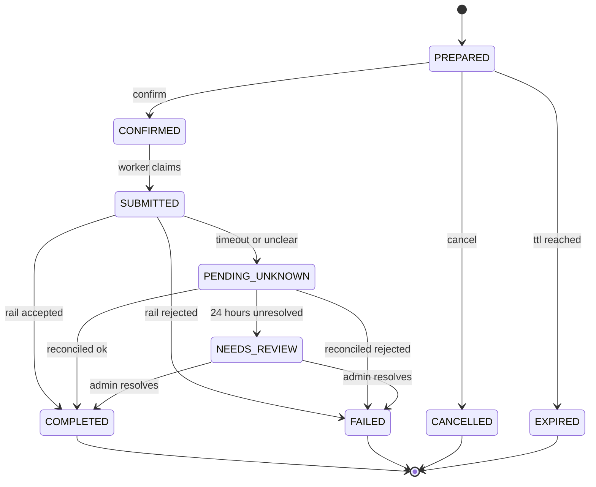
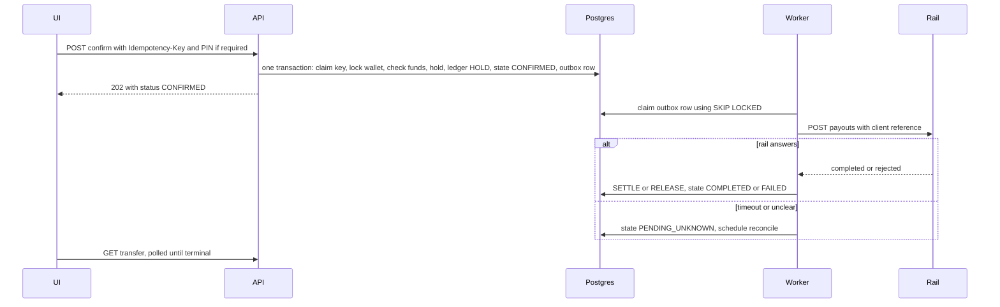

# Architecture: Sahayak

Status: DRAFT for approval. Implements `PRD.md`. Significant decisions are recorded in `specs/decisions/` (ADR-001 to ADR-013) and indexed at the end.

## 1. Design principles

1. **The model proposes, deterministic code disposes.** The LLM output is untrusted input. It is validated into a proposal, checked by a policy engine, and executed by typed tools using the authenticated user's identity.
2. **Facts come from tools, words come from templates.** Balances, amounts, recipients and statuses are rendered from database results through locale templates. The model never writes a number a user relies on.
3. **Data minimization toward the model.** Prompts contain only the user's own messages and curated knowledge-base text. Ledger and beneficiary data never enter prompts, which also shrinks the prompt-injection surface.
4. **Fail closed, degrade gracefully.** Anything unclear becomes a clarification or a refusal. When the LLM is down, deterministic quick actions still work.
5. **Money is a state machine on one source of truth.** Postgres holds all money state; every change is a transaction with a recorded transition; every external call is idempotent.
6. **Boring, scalable shape.** A modular monolith with a worker and a simulated partner, stateless processes, and ports and adapters at every external boundary. Split later only when a measurement says so.

## 2. System context



## 3. Deployable units

| Unit | Role | Notes |
|---|---|---|
| `web` | React and Vite single-page app: customer chat and the role-gated admin console. | Static build behind the reverse proxy. |
| `server` (api command) | Fastify HTTP API, SSE streaming, assistant turn pipeline, admin APIs. | Stateless; scale by replicas. |
| `server` (worker command) | Outbox processor, rail submission, reconciliation, expiry and purge jobs. | Same image and code as the API, different command. Several can run at once. |
| `mock-rail` | Simulated payment partner: idempotent payouts by client reference, fault injection (latency, 5xx, timeouts, lost responses, duplicates). | Lets reliability be tested for real. |
| `postgres` | System of record. | Money, audit, conversations, LLM call log, eval results. |
| `redis` | Dialog state, rate limits, shared circuit-breaker state, short caches. | Losing it never loses money state. |
| `proxy` | Reverse proxy (round-robin, no sticky sessions). | Enables the scale test. |
| `observability` profile | Prometheus, Grafana, Jaeger (OTLP). | Optional compose profile. |

## 4. Repository layout and dependency rules

```
sahayak/
  apps/
    server/       api and worker entrypoints, HTTP adapters, DB and Redis adapters, composition root
    mock-rail/    simulated payment partner
    web/          React app (customer chat and admin console)
  packages/
    shared/       Zod contracts: API, SSE events, enums, locale catalogs (no logic dependencies)
    core/         pure domain and application logic: money, ledger rules, transfer state machine,
                  policy engine, interpreter, dialog manager, number and date parsers, templates, redaction
    llm/          LLM gateway adapters: OpenAI-compatible, scripted fake, retry and breaker wrappers
    evals/        datasets, runners, reports (CLI)
  infra/          compose files, proxy config, Prometheus rules, Grafana dashboards, k6 scripts
  specs/          source of truth for requirements and decisions
  .github/workflows/
```

Dependency direction (enforced by dependency-cruiser in CI, NFR-MAINT-1):

- `shared` imports nothing internal.
- `core` may import `shared` only. No Fastify, SQL, Redis or HTTP clients. It defines ports (interfaces) such as `LlmClient`, `WalletRepo`, `TransferRepo`, `AuditSink`, `Clock`, `DialogStore`.
- `llm` imports `core` ports and `shared`.
- `apps/server` implements the ports with adapters and wires everything in one composition root.
- `evals` imports `core`, `llm`, `shared`, and talks to a running server over HTTP for workflow scenarios.
- `web` imports `shared` only.
- No cycles. Adapters never import each other.

The HTTP layer is a thin adapter over application services, so Fastify could be replaced by Express or NestJS without touching `core` (ADR-002).

## 5. The assistant turn pipeline



Stages in order (details in F02 and F03):

1. **Authenticate and limit.** Verify token, apply per-user and per-IP limits, reject oversized input.
2. **Normalize.** Unicode normalization, control-character stripping, script and language detection (en, hi, hi-Latn), deterministic amount and date parsing from the raw text, PII redaction for the prompt.
3. **Dialog manager.** Load short-lived state. If a transfer is pending and the message is exactly a confirm or cancel phrase (and no PIN is required), handle it deterministically with no model call.
4. **Interpreter.** One LLM call returning a structured interpretation: language, intent, entities, confidence, missing fields. Validate, repair once, cross-check the amount against the deterministic parse.
5. **Policy engine.** A pure decision table: ALLOW, CLARIFY (with the missing slot), NEEDS_CONFIRMATION, or DENY (with a reason), based on intent, role, limits and state.
6. **Tool execution.** Typed tools call application services as the authenticated user. Recipient resolution happens here, server-side. At most 4 tool executions per turn.
7. **Respond.** Templates render the result in the user's locale. Only FAQ answers use a second LLM call, grounded on retrieved knowledge-base snippets and passed through the output guard.
8. **Persist and emit.** Store the message with interpretation and policy decision, write audit and LLM-call records, stream SSE events (`status`, `delta`, `card`, `final`, `error`).

If the LLM stage fails, the pipeline returns the fallback menu (FR-CONV-5). Informational and transfer APIs remain reachable directly.

## 6. Money model and transfer lifecycle

Amounts are integer paise (`BIGINT`). Each wallet has `available_minor` and `held_minor`, both non-negative. The `ledger_entries` table is append-only with kinds `CREDIT`, `HOLD`, `SETTLE`, `RELEASE`. Invariants, checked by property tests and a periodic consistency query:

- `available = sum(CREDIT) - sum(HOLD) + sum(RELEASE)`
- `held = sum(HOLD) - sum(SETTLE) - sum(RELEASE)`
- `available >= 0` and `held >= 0`



Every transition writes a `transfer_events` row and an audit entry. COMPLETED writes SETTLE; FAILED writes RELEASE (funds return to available).

Confirm and settlement flow:



Why this is safe: the hold and the outbox row commit together (no lost or phantom payout); the rail call is idempotent on the client reference (a retry or crash cannot pay twice); a lost response ends in PENDING_UNKNOWN and is resolved by looking the payout up, never guessed; the assistant words its messages from the stored state.

## 7. Where state lives

| State | Store | Notes |
|---|---|---|
| Users, wallets, ledger, transfers, events, beneficiaries | Postgres | Source of truth. |
| Conversations, messages, tool invocations, LLM calls | Postgres | Masked content; retention configurable. |
| Audit log | Postgres, insert-only role | Hash-chained. |
| Idempotency keys, outbox | Postgres | Same transaction as the business change. |
| Eval runs and results, knowledge base, tickets | Postgres | |
| Dialog state (pending clarification, pending transfer id) | Redis, 30-minute TTL | Rebuildable: the pending transfer is also in Postgres. |
| Rate-limit counters, login throttles, circuit-breaker state | Redis | Shared across replicas. |

## 8. LLM gateway

A single port, `LlmClient.completeStructured(request, schema)`, with adapters:

- **OpenAI-compatible adapter**: base URL, key and model come from config, so the same code reaches the hosted model and a local Ollama or vLLM server.
- **Scripted fake**: returns predefined outputs keyed by utterance. Used in unit, integration, end-to-end and CI workflow evals.
- **Wrappers** (decorators): timeout, retry with jittered backoff, circuit breaker with state in Redis, redaction for providers not marked `trusted`, metrics and the `llm_calls` record.

Structured output: request JSON-schema output where the provider supports it, otherwise JSON mode with the schema in the prompt; always validate with Zod; on failure send one repair request that includes the validation errors; then give up to clarification or fallback. Temperature 0, capped output tokens. Thinking mode is turned off for classification on models that have it.

## 9. Security architecture

| Boundary | Treated as | Controls |
|---|---|---|
| Browser to API | Untrusted | Token auth, RBAC, object checks, input schemas, CORS, headers, rate limits |
| LLM output | Untrusted | Schema validation, policy engine, allowlisted tools, no authority |
| User text, notes, names | Untrusted data | Delimited in prompts, escaped in the UI, never concatenated into instructions |
| Tools and services | Trusted, authenticated | Run as the token's user; every call audited |
| Rail webhooks and responses | Semi-trusted | Signature check (webhook), idempotent state transitions |
| Logs and telemetry | Must be clean | Masking at the logger and exporter |

Transfer confirmation never depends on the model: it is the confirm API (button, plus PIN above the threshold) or a deterministic phrase match against one pending transfer.

## 10. Reliability patterns

Idempotency keys with request hashing; transactional outbox with `FOR UPDATE SKIP LOCKED` workers; row-level wallet locking; explicit state machine with allowed-transition table; timeouts everywhere; retries only on idempotent operations; circuit breaker around the LLM; fallback mode; reconciliation job for ambiguous outcomes; graceful shutdown; readiness tied to dependencies.

## 11. Observability

- **Logs:** pino JSON, request id on every line, redaction at the logger.
- **Metrics:** `/metrics` with HTTP RED metrics, `llm_request_duration_seconds{provider,model,outcome}`, `llm_tokens_total`, `interpreter_validation_failures_total`, `assistant_intent_total{intent,lang}`, `assistant_fallback_total{reason}`, `tool_invocations_total{tool,outcome}`, `transfers_total{status}`, `transfer_stuck_count`, `idempotency_replays_total`, `rate_limited_total`, `outbox_lag_seconds`, `rail_requests_total{outcome}`.
- **Traces:** OpenTelemetry spans for HTTP, interpreter, LLM, each tool, SQL, rail; trace id echoed in logs and errors.
- **Dashboards (Grafana, as code):** API health, assistant quality (intent mix, fallbacks, validation failures), LLM latency and errors, transfer funnel, reliability (outbox lag, stuck transfers, replays).
- **Alerts (Prometheus rules, as code):** LLM error ratio above 20% for 5 minutes, outbox lag above 60 s, any PENDING_UNKNOWN older than 30 minutes, 5xx ratio above 1%, audit verification failure.
- **LLM observability:** every call stored in `llm_calls` (masked prompt and response, tokens, latency, outcome, validation error) and viewable in the admin console.

## 12. Scalability

What scales now (tested in T43 and T24): stateless `server` replicas behind the proxy with no sticky sessions; shared Redis for limits and breaker state; workers scale independently and cannot double-process (`SKIP LOCKED`); read endpoints are cheap indexed queries. A turn is one request with an SSE response, so there is no cross-replica streaming problem.

The contention point is intentionally narrow: only the sender's wallet row is locked, and only during confirm.

What would come next (documented, not built): read replicas for history and admin queries; partition `ledger_entries` and `audit_log` by time; replace the outbox poller with a broker when throughput demands it; extract the LLM gateway into its own service with request queuing and response caching; move model serving to a GPU pool with vLLM; per-tenant sharding if the product becomes multi-tenant.

## 13. Deployment topologies

- **Local:** `docker compose up` (api, worker, mock-rail, web, proxy, postgres, redis, seed data). `--profile observability` adds Prometheus, Grafana, Jaeger. A `--profile local-llm` option points the gateway at an Ollama server on the host.
- **CI:** GitHub Actions with Postgres and Redis service containers.
- **Staging (stretch, FR-OPS-4):** containers on a free-tier host with managed Postgres and Redis; hosted model only. Outcome documented either way.

## 14. Technology choices and trade-offs

| Concern | Choice | Main alternative | Reason |
|---|---|---|---|
| Runtime and language | Node.js 22 LTS, TypeScript strict | Python | One language across API, worker and UI contracts |
| HTTP framework | Fastify with Zod type provider | Express, NestJS | Schema-first validation fits the safety story; light and fast; replaceable behind adapters |
| Contracts | Zod in `shared`, OpenAPI generated | Hand-written OpenAPI | One source of truth for runtime validation, types and docs |
| Database access | Kysely over `pg`, SQL migrations | ORM (Prisma, Drizzle) | Money paths need explicit SQL, locks and transactions with full type safety |
| Queue | Postgres outbox with SKIP LOCKED | BullMQ, Kafka | Transactional with the business write, no dual-write, fewer moving parts |
| Auth | JWT access plus rotating refresh, argon2id | Sessions, OIDC provider | Demonstrates token handling without an external IdP |
| LLM integration | OpenAI-compatible HTTP, own structured-output layer | Vendor SDKs, native tool calling | Provider-agnostic; reliable with small open models |
| Frontend | React, Vite, TanStack Query | Next.js | Pure SPA is enough; SSE client is simple |
| Tests | Vitest, real Postgres and Redis, Playwright, k6, fast-check | Mocked DB | Money and concurrency bugs only show up against real databases |
| Observability | OpenTelemetry, Prometheus, Grafana, Jaeger | Hosted APM | Free, local, reproducible |

## 15. ADR index

| ADR | Title |
|---|---|
| 001 | Modular monolith with worker and simulated rail |
| 002 | Node.js, TypeScript, Fastify, Zod, pnpm monorepo with enforced boundaries |
| 003 | The model proposes, policy disposes |
| 004 | Structured output with validation and repair, behind an LLM gateway |
| 005 | Money as integer paise with a hold-based ledger in Postgres |
| 006 | Idempotency design |
| 007 | Transactional outbox with SKIP LOCKED workers |
| 008 | Confirmation channels never include the model |
| 009 | Hash-chained, insert-only audit log |
| 010 | Authentication and token strategy |
| 011 | Observability stack |
| 012 | Testing strategy with real dependencies and scripted models |
| 013 | Facts from templates, language handling and locale catalogs |
